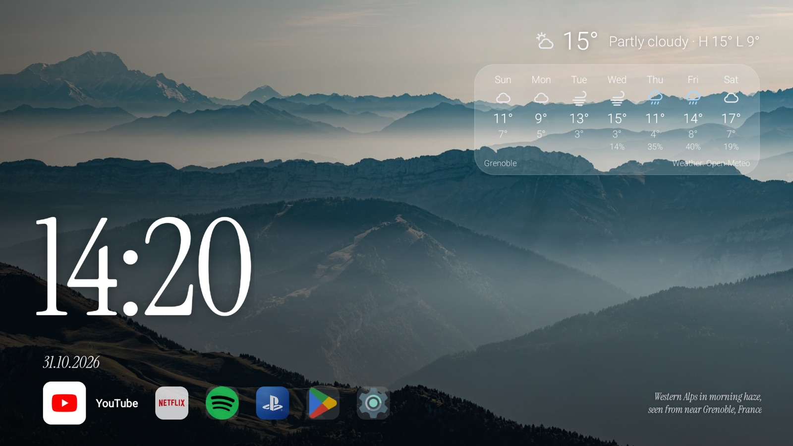
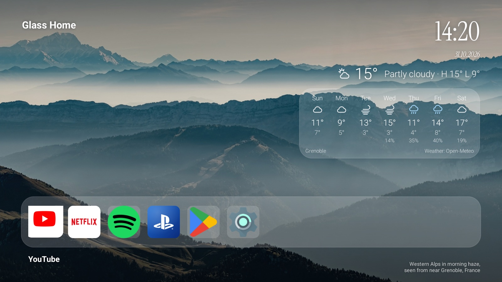
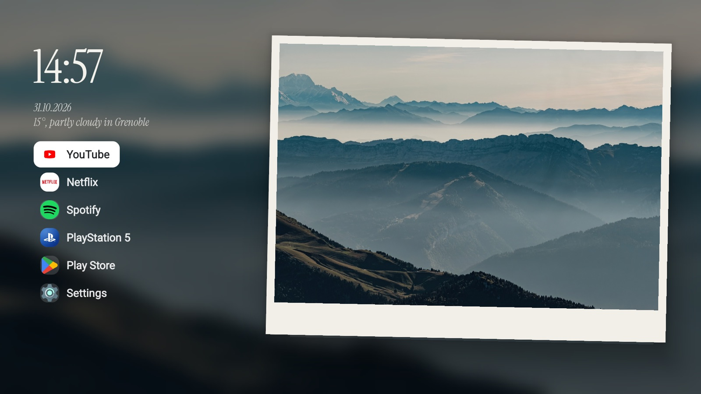
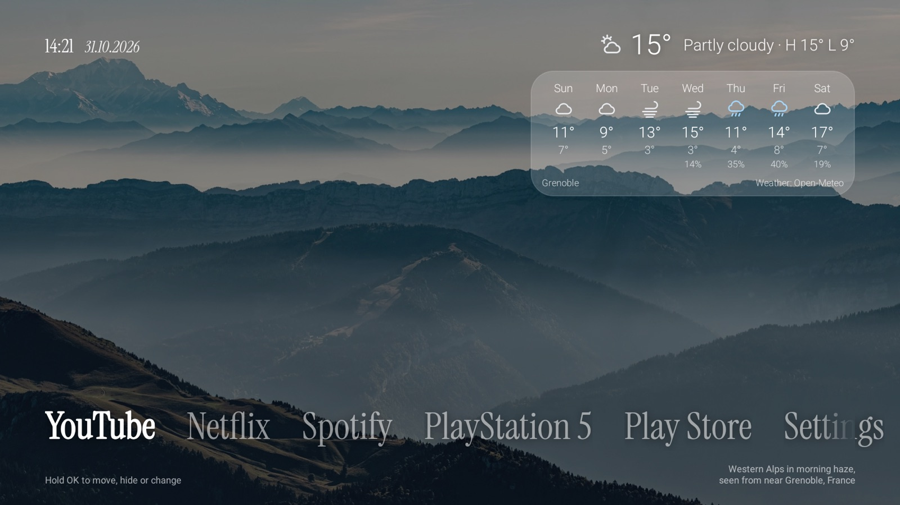

<h1 align="center">Glass Home for Android TV</h1>

<p align="center">
  A calm, fast home screen for Android TV and Google TV: a big serif clock over<br>
  rotating nature photos, a quiet row of your apps, and nothing else.<br>
  No ads, no recommendation rows, no tracking.
</p>

<p align="center">
  
  
  <a href="LICENSE"></a>
  <a href="https://buymeacoffee.com/mike_kiselyov"></a>
</p>

<p align="center">
  
</p>

Glass Home replaces the home screen, and the scripts that come with it clean
up a slow, ad-filled TV over adb. Everything is backed up first and undone with
one command. Based on [Glass Home for Samsung TVs](https://github.com/victaphu/glass-home-samsung-tv)
by victaphu, rebuilt as a native Android app.

## Set it up

You need a computer with [adb](https://developer.android.com/tools/releases/platform-tools)
on the TV's Wi-Fi, and this repository (Code > Download ZIP, or `git clone`).

1. **On the TV**: Settings > System > About > click **Android TV OS build**
   (or **Build**) 7 times. Then Settings > System > Developer options >
   **Wireless debugging** on.
2. **Pair the computer once**: Wireless debugging > **Pair device with pairing
   code** shows an address and a code. Give both to the script:

   ```sh
   scripts/tv/pair.sh 192.168.1.20:37000 123456
   ```

3. **Run the set-up**. It backs up the TV, then asks what to do; Enter takes
   the recommended answer.

   ```sh
   scripts/setup.sh                   # Glass Home and the clean-up, asks before each step
   scripts/setup.sh --only glasshome  # only Glass Home
   scripts/setup.sh --only clean      # only the clean-up, the TV keeps its own home screen
   ```

To build nothing, download `glass-home.apk` from
[Releases](https://github.com/MikeKiselyov/glass-home-android/releases) and add
`--apk glass-home.apk`. Every option, and what to do when something goes
wrong: [docs/INSTALL.md](docs/INSTALL.md).

**Going back**: `scripts/restore.sh` undoes every change, newest first
(`--dry-run` shows what it would do, `--uninstall` removes Glass Home too).
Nothing is ever uninstalled by the set-up: apps are only switched off.

### Or let Claude Code do it

The whole thing started as one prompt to [Claude Code](https://claude.com/claude-code).
Open a terminal in this repository and try:

> My Android TV is slow and full of ads. Find it on my Wi-Fi, connect over ADB
> and clean it up: turn off the maker's ads, telemetry and junk apps (reversibly,
> uninstall nothing), asking me first about apps and features I might use. Then
> install Glass Home from this repo as the home screen. Back up before any
> change, check each step with screenshots from the TV and keep restore.sh up to date.

## What you get

- **Four themes**, five clock fonts, six date formats, weather styles, night mode.
- **Photos**: 12 nature photos, your own, or a shared iCloud / Google Photos album.
- **Dock**: your apps plus what is plugged into HDMI ("PlayStation 5"), icons
  you can change, colour buttons on the remote for favourite tiles.
- **Weather** (Open-Meteo, no account) and **now playing** for Spotify and
  YouTube Music.
- **Set up from your phone**: scan a QR code on the TV; or with the remote on
  the TV itself.
- **Open on the TV**: send a link from the phone (one tap from the iPhone's
  Share menu); it opens in YouTube or in a browser on the TV, waking it first.
- **Sleep timer** and a **screensaver** with your photos and the clock.
- **Updates from GitHub, only when you say so**: Install, Later or Skip this version.
- **English, Ukrainian, Belarusian**.

How to use all of it: [docs/USING.md](docs/USING.md).

## Why it doesn't lag

Measured on a 2 GB Google TV after a factory reset, Glass Home against Google
TV's own home screen ([all numbers](docs/SPEED.md)):

- **Home opens in 0.06 s.** An accessibility service catches the Home key
  before Google TV sees it, so Google TV's home screen doesn't start at all.
- **A ninth of the frames.** The focus moves along the dock; rows don't slide.
  For the same arrow presses Glass Home draws 25 frames, Google TV 228, most of
  them slower than 60 per second.
- **A third of the memory**: 45 MB on screen, 35 MB behind another app, against
  126 / 124 MB. Photos sit in graphics memory and are dropped when another
  app is in front; the settings run in a process of their own that ends when
  they close.
- **Compiled ahead of time** when installed, so it starts in 0.38 s from the
  first day instead of after Android's overnight compile.
- **The clean-up** switches off ad, tracking and demo services: 25 apps running
  instead of 41, and system animations at half length.
- **Two settings worth checking**: Developer options > Don't keep activities
  off (with it on, Home took 0.6 s instead of 0.15 s); and Photos > Slow zoom
  off on the website for an idler TV (1.7% CPU instead of 2.1%).

Free memory on the whole TV stays about the same: Google TV can't be removed
and stays in memory. What else can go: [docs/SPEED.md](docs/SPEED.md#more-room-on-a-google-tv).

## Themes

<table>
  <tr>
    <td width="50%"></td>
    <td width="50%"></td>
  </tr>
  <tr>
    <td><b>Clock</b>: big serif clock bottom left, small icons.</td>
    <td><b>Glass</b>: clock top right, frosted dock of large icons.</td>
  </tr>
  <tr>
    <td></td>
    <td></td>
  </tr>
  <tr>
    <td><b>Postcard</b>: the photo as a postcard, app menu on the left.</td>
    <td><b>Type</b>: apps as large words, no icons.</td>
  </tr>
</table>

## Privacy

The app talks to Open-Meteo for weather (once you pick a city), your shared
album's host (once you add a link) and GitHub, once a day, for new releases
(off on the website); nothing else. The accessibility service acts only on the
Home key, keeps and sends nothing, and can't read the screen. The phone
website answers only your home network and needs the code from the TV; it is
plain HTTP, so anyone on the same Wi-Fi could read it. Details:
[docs/USING.md](docs/USING.md#privacy).

## Status

Built and used on one TV (Smarttech Apollo Premium 4K, Google TV, Android 14).
It should work on any Android TV 8.0+ or Google TV; other TVs are untested.
Reports and pull requests are welcome, especially additions to
[debloat/packages.tsv](debloat/packages.tsv) for your TV brand. Releases are
tested and published by CI on every merge: [docs/RELEASING.md](docs/RELEASING.md).

## Support

Glass Home is free and open source. If it made your TV nicer to use, you can buy me a coffee:

<a href="https://buymeacoffee.com/mike_kiselyov"></a>

## Credits and licences

- Code: MIT, see [LICENSE](LICENSE). Based on Glass Home for Samsung TVs by
  victaphu ([MIT](licenses/MIT-glass-home-samsung-tv.txt)).
- Photos: CC0, see [CREDITS.md](CREDITS.md).
- Fonts: SIL Open Font License, see [licenses](licenses) and [CREDITS.md](CREDITS.md).
- Not affiliated with Google, Sony, Microsoft, Nintendo, Apple or any app shown.
