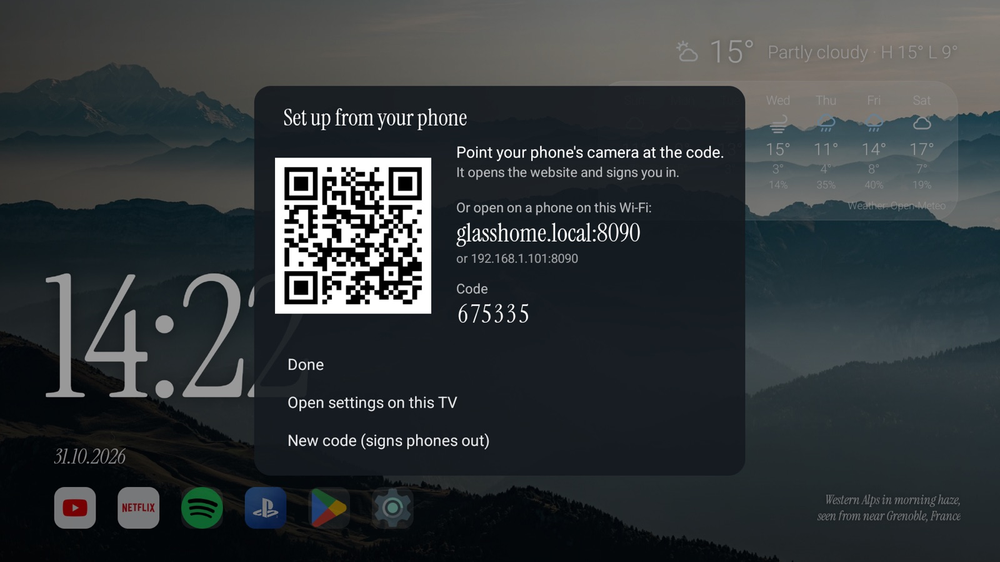
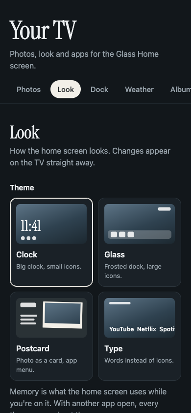
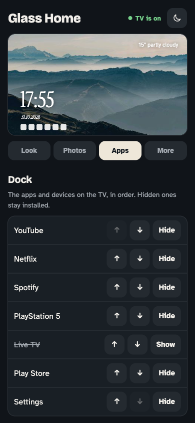
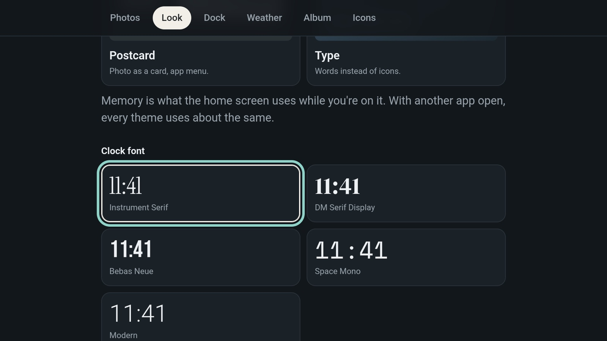
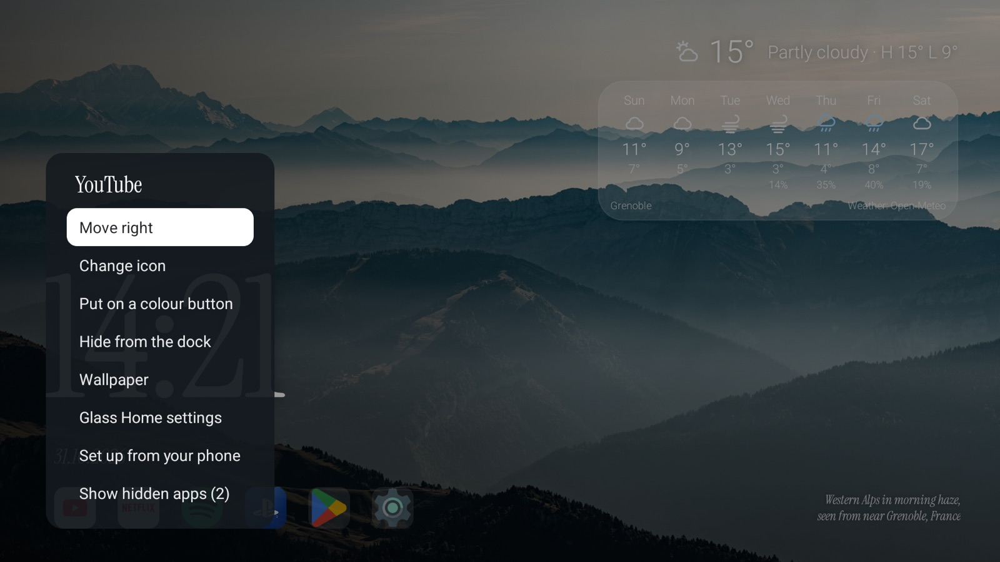

<h1 align="center">Glass Home for Android TV</h1>

<p align="center">
  A calm, fast home screen for Android TV and Google TV: a big serif clock over<br>
  rotating nature photos, a quiet row of your apps, and nothing else.<br>
  No ads, no recommendation rows, no tracking.
</p>

<p align="center">
  
  
  <a href="LICENSE"></a>
</p>

<p align="center">
  
</p>

It also comes with scripts that clean up a slow, ad-filled TV over adb: a
backup first, then switching off ads, tracking and apps you don't use, all of
it reversible with one command.

Based on [Glass Home for Samsung TVs](https://github.com/victaphu/glass-home-samsung-tv)
by victaphu, rebuilt as a native Android app.

## Contents

- [What you get](#what-you-get)
- [Themes](#themes)
- [Set up from your phone](#set-up-from-your-phone) or [on the TV](#settings-on-the-tv)
- [Speed and memory](#speed-and-memory)
- [Set up](#set-up) (install on your TV) and [going back](#going-back)
- [Using it](#using-it)
- [Good to know](#good-to-know), [More room on a Google TV](#more-room-on-a-google-tv) and [Privacy](#privacy)

## What you get

- **Four themes**: Clock (big serif clock, small icons), Glass (frosted dock),
  Postcard (the photo as a card, an app menu) and Type (words instead of
  icons). Pick one on the phone website; see [Themes](#themes) for memory use.
- **Your style**: five clock fonts, six date formats (written out or digits),
  five weather styles (words, icon, temperature only, large corner, corner
  with a 3-day forecast), 12/24-hour clock.
- **Photos**: 12 CC0 nature photos, your own from your phone, or a shared
  iCloud / Google Photos album that syncs by itself. Portrait photos are shown
  whole over a blurred copy; landscape ones are cropped around faces. Shuffle,
  or drag them into your own order.
- **Dock**: the TV's installed apps plus whatever is plugged into HDMI, named
  by HDMI-CEC ("PlayStation 5"). A green dot shows when a console is on.
- **Icons you can change** on any tile: the app's own, drawn device icons in
  three styles, or any picture you upload.
- **Weather** next to the date (Open-Meteo, no account or key).
- **Now playing**: track and cover art while Spotify or YouTube Music plays.
- **Night mode**: a warm, dim screen in the evening.
- **Colour buttons** on the remote open the tiles you assign to them.
- **A website on the TV** for your phone at `http://glasshome.local:8090`:
  scan the QR code on the TV and you're in. Upload and order photos and icons,
  pick the theme, font and city, reorder the dock. Home network only, behind
  a code shown on the TV.
- **Light**: about 35 MB of memory while another app is open; Google TV's
  home screen keeps about 120 MB.

## Themes

Pick one on the phone website; the TV changes straight away.

<table>
  <tr>
    <td width="50%"></td>
    <td width="50%"></td>
  </tr>
  <tr>
    <td><b>Clock</b>: big serif clock bottom left, small icons.</td>
    <td><b>Glass</b>: clock top right, frosted dock of large icons.</td>
  </tr>
  <tr>
    <td></td>
    <td></td>
  </tr>
  <tr>
    <td><b>Postcard</b>: the photo as a postcard on a blurred copy, app menu on the left.</td>
    <td><b>Type</b>: apps as large words, no icons.</td>
  </tr>
</table>

Postcard keeps a blurred copy of the photo behind the card, so it uses a
little more memory than the others. With another app in front every theme
drops its photos. Numbers: [Speed and memory](#speed-and-memory).

## Set up from your phone

Hold **OK** on any app and choose **Set up from your phone**. Scan the code
with your phone's camera: the TV's website opens and you're signed in. Or
type `glasshome.local:8090` on a phone on the same Wi-Fi and enter the code.

<p align="center">
  
</p>

The website shows the TV as it is right now at the top: its photo with the
clock, date, weather and dock drawn the way you set them, so every change can
be seen before you look up. Below it, four tabs:

- **Look**: theme, clock (24 h, 12 h or the TV's setting), clock font, date,
  weather style and night mode.
- **Photos**: add photos, shuffle or your own order, how long each one stays,
  slow zoom on or off.
- **Apps**: the dock in order, hide or show, and the colour buttons.
- **More**: the weather city, a shared iCloud or Google Photos album, icons.

It follows the phone's light or dark setting; the sun/moon button at the top
switches it, and the phone remembers the choice.

<p align="center">
  
  &nbsp;&nbsp;
  
</p>

## Languages

All text, on the TV and on the phone website, lives in one file:
[app/src/main/assets/i18n/en.json](app/src/main/assets/i18n/en.json). To add a
language, copy it to `<code>.json` (for example `ru.json`), translate the
values and rebuild; keys you leave out fall back to English. The language is
then offered on the phone website. Two strings Android reads itself (the app
name and the accessibility description) are in `res/values/strings.xml`; add
`res/values-<code>/strings.xml` for those.

## Status

Built and used on a Smarttech Apollo Premium 4K (Google TV, Android 14,
MediaTek, 2 GB RAM). It should work on any Android TV 8.0+ or Google TV, but
other TVs are untested. Reports and pull requests are welcome, especially
additions to [debloat/packages.tsv](debloat/packages.tsv) for your TV brand.

## Requirements

- A computer with [adb](https://developer.android.com/tools/releases/platform-tools)
  (`brew install --cask android-platform-tools` on a Mac).
- To build: JDK 17+ and the Android SDK (platform 34). Or use a release APK.
- On the TV: Developer options (Settings > System > About > tap Build 7 times)
  and Wireless debugging (Settings > System > Developer options).

## Settings on the TV

No phone at hand? Open **Home settings**, the last tile on the dock in every
theme (or hold **OK** on any app and choose **Glass Home settings**). The same
website opens on the TV, already signed in, with the tabs down the left. Arrows move between
controls, **OK** picks, **Back** closes it. Adding photos and icons needs a
phone (files come from there); everything else works with the remote.

<p align="center">
  
</p>

## Speed and memory

Measured on the TV it was built on (Smarttech Apollo Premium 4K, Google TV,
Android 14, 4 cores, 2 GB RAM) after a **factory reset**, set up the way a
buyer would: Google account, every default accepted, and the apps Google TV
installs by itself. Three states, a reboot before each, the same script for
all of them, Glass Home's release build with the default Clock theme:

| | Factory, Google TV | Clean-up, Google TV | Clean-up + Glass Home |
|---|---|---|---|
| Free memory on the TV | 542 MB | 535 MB | 557 MB |
| Home screen memory, on screen | 126 MB | 130 MB | 79 MB |
| Home screen memory, behind another app | 119 MB | 124 MB | 57 MB |
| Google TV's launcher in memory | 130 MB | 135 MB | 94 MB |
| Apps running | 41 | 25 | 24 |
| Idle CPU, home screen (one core) | 0.2% | 0.1% | 1.9% |
| Idle CPU, whole TV | 6.1% | 5.6% | 5.7% |
| Home key to the home screen | - | - | 0.05 s |
| Frames for the same arrow keys: drawn, slower than 60 per second | 228, 201 | 215, 182 | 25, 5 |

- **Clean-up** is `scripts/setup.sh --yes`: 8 packages switched off (ad
  services, on-device ad personalisation, federated compute, ACR, feedback,
  store demo, factory test) and animations at half length. It barely changes
  memory or CPU; it removes the ad and tracking services and leaves fewer
  apps running in the background.
- **Free memory stays about the same** with Glass Home. Glass Home itself
  takes half of what Google TV's home screen takes, but Google TV can't be
  removed: it starts once when the TV boots and stays in memory next to
  Glass Home (pressing Home never starts it again).
- **Home key to the home screen** is from the key press to Glass Home's first
  frame (`scripts/measure-home.sh`); Google TV doesn't start on the way. With
  Home going to Google TV first (still a choice on the website) it is about
  0.4 s.
- **Frames**: Google TV animates its rows and draws most frames slower than
  60 per second (typically 30 ms each). Glass Home moves the focus without
  animating rows, so it has about a ninth of the frames to draw.
- **Idle CPU** is the one place Glass Home costs more: the photo's slow zoom,
  in steps too small to see. **Photos > Slow zoom** off on the website keeps
  the photos still and the TV idler.
- The factory state was measured 2 minutes after boot, so some of its 41 apps
  were still starting up.

Measure your own TV the same way:

```sh
scripts/compare.sh before    # the TV as it is, 3 runs, about 7 minutes
scripts/setup.sh
scripts/compare.sh after     # prints the before/after table
```

The table above is release 0.2.0. Since 0.3.0 photos are held in graphics
memory, the zoom steps less often and the settings on the TV run in a
process of their own, which used to leave 55 MB behind after every visit.
Same TV, same script, 3 runs each:

| | 0.2.0 | 0.3.0, slow zoom on | 0.3.0, still photos |
|---|---|---|---|
| Glass Home, on screen / behind another app | 109 / 89 MB | 45 / 35 MB | 44 / 34 MB |
| Idle CPU, Glass Home (one core) | 2.9% | 2.1% | 1.7% |
| Cold start: first frame / tiles on screen | 0.49 s / - | 0.38 / 0.41 s | - |
| Home key to the home screen | 0.06 s | 0.06 s | 0.06 s |

The 0.2.0 column probably includes a settings visit left in memory (on the
freshly reset TV it measured 79 / 57 MB). Per-theme numbers come from
`scripts/measure.sh`, which needs a debug build.

## Set up

**Step-by-step guide, including what to do when something goes wrong:
[docs/INSTALL.md](docs/INSTALL.md).** The short version:

1. On the TV: Settings > System > About > click **Build** 7 times, then
   Settings > System > Developer options > **Wireless debugging** on.
2. Pair the computer once (Wireless debugging > Pair device with pairing code):

   ```sh
   scripts/tv-pair.sh 192.168.1.20:37000 123456
   ```

3. Run the set-up. It backs up the TV first, installs Glass Home and asks
   about each step; Enter takes the recommended answer.

   ```sh
   scripts/setup.sh           # asks
   scripts/setup.sh --yes     # recommended answers, no questions
   ```

| Step | Option | Recommended | What it does |
|---|---|---|---|
| Install | `--apk <file>` | build from source | Installs a downloaded APK instead of building (building needs JDK 17+ and the Android SDK) |
| Home button | `--home on\|off` | on | Home opens Glass Home (see [Good to know](#good-to-know)) |
| Now playing | `--now-playing on\|off` | on | Track and cover art while Spotify or YouTube Music plays |
| Clean-up | `--clean ask\|junk\|none` | junk | Switches off ads, tracking and demo apps from [debloat/packages.tsv](debloat/packages.tsv); `ask` goes one by one, features you might use (voice search, Chromecast) are only switched off when you say so |
| Animations | `--animations 0.5\|1\|keep` | 0.5 | System animations twice as fast |
| Ad-blocking DNS | `--dns adguard\|keep` | keep | AdGuard's Private DNS for every app (not YouTube ads) |
| Screensaver | `--screensaver keep\|colors\|off` | keep | Google's photo screensaver uses the network and memory while the TV is idle |

Each step is also its own script in [scripts](scripts) (`deploy.sh`,
`set-home.sh`, `debloat.sh`, `speed.sh`, `private-dns.sh`,
`enable-now-playing.sh`) if you'd rather run them one at a time. All of them
find the TV on your network by themselves. Nothing is ever uninstalled: apps
are switched off with `pm disable-user` and come back with `pm enable`.

### Going back

- **A backup before every change.** `setup.sh` and `restore.sh` save the TV's
  state to `.tv/backup/<date-time>/` first: every app and whether it is on,
  all system settings, the Home app, a screenshot and a copy of the change
  log. Old backups are never deleted.
- **Every change is written down** in `.tv/changes.log` with the value it
  replaced.
- **One command undoes it all**, newest change first:

  ```sh
  scripts/restore.sh --dry-run    # shows what it would do
  scripts/restore.sh              # does it; Glass Home stays installed
  scripts/restore.sh --uninstall  # also removes Glass Home
  ```

- **Without the computer**: Settings > Accessibility > Glass Home off gives the
  Home button back to Google TV; Settings > Apps > (app) > Enable brings back
  anything that was switched off.

### Or let Claude Code do it

The whole thing started as one prompt to [Claude Code](https://claude.com/claude-code).
Open a terminal in this repository and try:

> My Android TV is slow and full of ads. Find it on my Wi-Fi, connect over ADB
> and clean it up: turn off the maker's ads, telemetry and junk apps (reversibly,
> uninstall nothing), asking me first about apps and features I might use. Then
> install Glass Home from this repo as the home screen. Back up before any
> change, check each step with screenshots from the TV and keep restore.sh up to date.

## Using it

- **OK** opens a tile. **Hold OK** for its menu: move, hide, change icon, put
  on a colour button, uninstall, app info, wallpaper, Glass Home settings,
  set up from your phone.
- **Uninstall** is there for apps you (or Google TV) installed; Android asks
  before removing anything. Apps built into the TV can't be removed: **App
  info** opens the system page where they can be switched off, stopped or
  have their updates removed.
- **Home settings**, the last tile, opens the settings on the TV. Hide or move
  it like any tile.
- **Back** closes a menu; on the home screen it does nothing.
- **Phone website**: hold OK on any tile > Set up from your phone. The TV
  shows a QR code, its address and a code. **New code** there signs every
  phone out.

<p align="center">
  
</p>

### Official logos

Icons for PlayStation, Xbox, Nintendo Switch and Apple TV are drawn from
scratch. If you'd rather have the brand logos on your own TV:

```sh
python3 scripts/make-official-icons.py   # downloads logos from Wikimedia Commons (macOS)
scripts/push-icons.sh                    # debug builds; or upload the PNGs on the phone website
```

The logos are trademarks of their owners. They stay on your computer and
your TV and are never part of this repository or the APK.

## Good to know

- **Google TV** ignores a third-party Home app while its own launcher is on.
  Disabling the launcher or the setup wizard is risky (on our test TV it cut
  the network and the TV forgot its Wi-Fi), so `set-home.sh` keeps both and
  turns on a small accessibility service instead. It catches the Home key on
  the remote and opens Glass Home, so Google TV's home screen doesn't start or
  flash at all. Holding Home no longer opens the Google TV panel. Google TV
  still opens once when the TV boots, and Glass Home comes in front of it.
  If catching the key doesn't work on your TV, set **More > Home button >
  After Google TV** on the website: Google TV opens first and Glass Home
  comes in front of it. The scripts refuse to disable a list of packages the
  TV needs (`scripts/changelog.sh`).
- **Force stop** on Glass Home (Settings > Apps) also switches its
  accessibility service off; Android does that to every app. Home then opens
  Google TV again until you run `scripts/set-home.sh` or turn it back on in
  Settings > Accessibility > Glass Home.
- **Developer options > Don't keep activities** should be off. With it on,
  Android closes every app the moment you leave it, so pressing Home builds
  the home screen again each time (0.6 s instead of 0.15 s on the test TV)
  and every other app starts from scratch too. Our test TV came with it on.
  Turn it off in Settings > System > Developer options; changing it with
  `adb shell settings` only takes effect after a reboot.
- **After a reboot** Wireless debugging may switch itself off. Turn it on
  again; you don't need to pair again.
- **System updates** can switch the accessibility service off. Run `set-home.sh` again.
- **Colour buttons** work while the home screen is in front.
- **Google Photos albums** are read from the public share page, which Google
  can change at any time. iCloud shared albums use Apple's web API.
- **YouTube ads** come from the same servers as the videos, so DNS blocking
  can't remove them.

## More room on a Google TV

What else kept memory on the test TV after the set-up, and what can be done
about it. Check yours with `adb shell dumpsys meminfo` (the "Total PSS by
process" list).

| What | Memory | Can it go? |
|---|---|---|
| Google Assistant (`com.google.android.katniss`) | about 65 MB | If you don't use the microphone button: `scripts/debloat.sh` offers it as a feature |
| Chromecast built-in (`com.google.android.apps.mediashell`) | about 25 MB | If you don't cast from a phone: `scripts/debloat.sh` |
| Apps Google TV installs during set-up (Apple TV, Max, Disney+, Prime Video...) | not running until used | Hold OK on the tile > Uninstall |
| Google TV's own home screen | about 120 MB | No: switching it off breaks the TV. It stays in memory next to Glass Home |
| Netflix and other apps you used | until Android needs the room | Nothing to do: Android unloads them when it needs the memory |

A plain screensaver (`scripts/setup.sh --screensaver colors`) keeps Google's
photo screensaver off the network while the TV is idle.

## Privacy

The app talks to: Open-Meteo for weather (once you pick a city), your shared
album's host (once you add a link), and nothing else.

The accessibility service that makes Home open Glass Home sees the keys
pressed on the remote, because that is how Android lets an app catch Home. It
acts only on Home, keeps nothing and sends nothing; the only thing it writes
to the system log is the time Home was pressed, for the speed numbers. It
cannot read what is on screen. The phone website only
answers devices on your home network, needs the code from the TV, and uses
plain HTTP, so anyone on the same Wi-Fi could read the traffic.

Guessing the code is limited: 5 wrong codes lock that phone out for 5 minutes,
and 20 wrong codes from any phones lock sign-in for everyone and replace the
code (each lockout in a row lasts twice as long). Phones stay signed in for 30
days.

## Releases

APKs on the [Releases](https://github.com/MikeKiselyov/glass-home-android/releases)
page are signed with one permanent key, so each release installs over the
previous one. How releases are made: [docs/RELEASING.md](docs/RELEASING.md).

## Credits and licences

- Code: MIT, see [LICENSE](LICENSE). Based on Glass Home for Samsung TVs by
  victaphu ([MIT](licenses/MIT-glass-home-samsung-tv.txt)).
- Photos: CC0, see [CREDITS.md](CREDITS.md).
- Fonts (Instrument Serif and the other clock fonts, Bricolage Grotesque and
  Atkinson Hyperlegible for the settings website): SIL Open Font License, see
  [licenses](licenses) and [CREDITS.md](CREDITS.md).
- Not affiliated with Google, Sony, Microsoft, Nintendo, Apple or any app shown.
