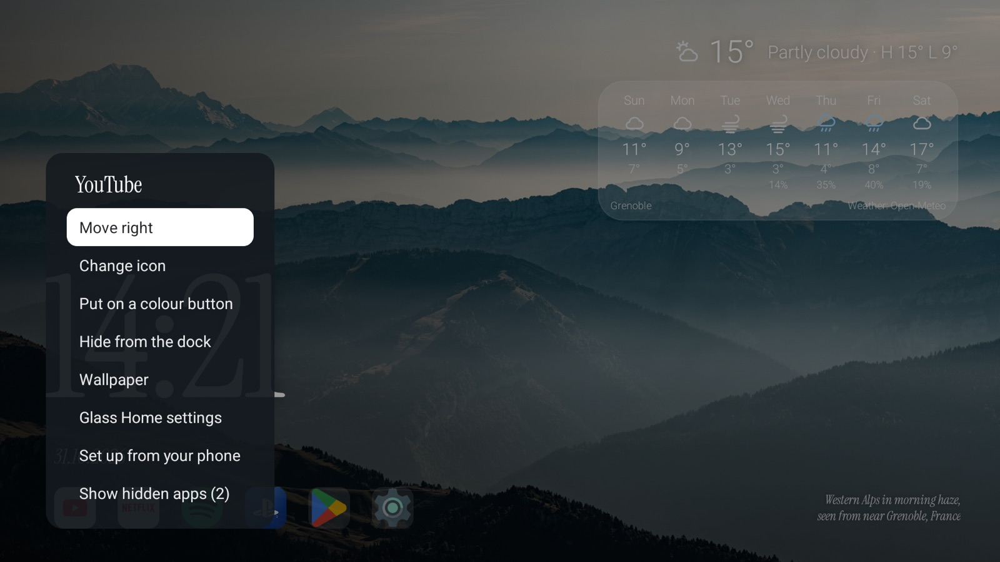
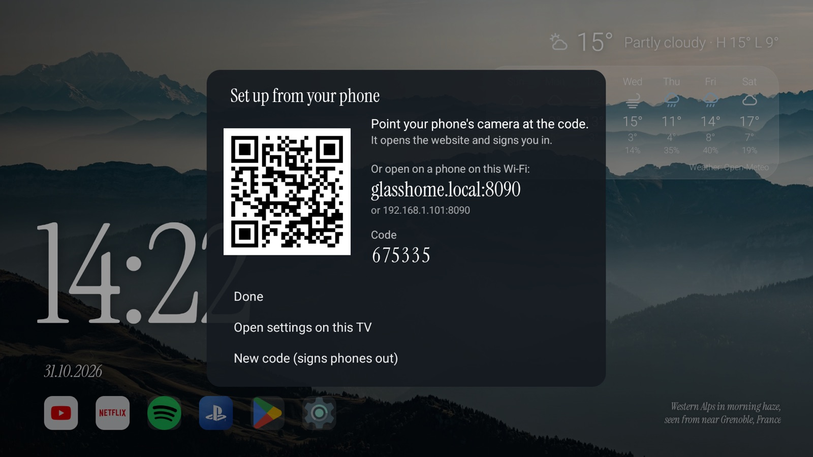
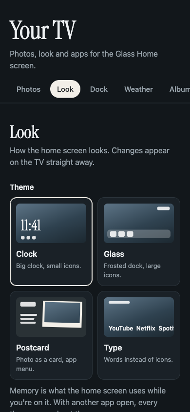
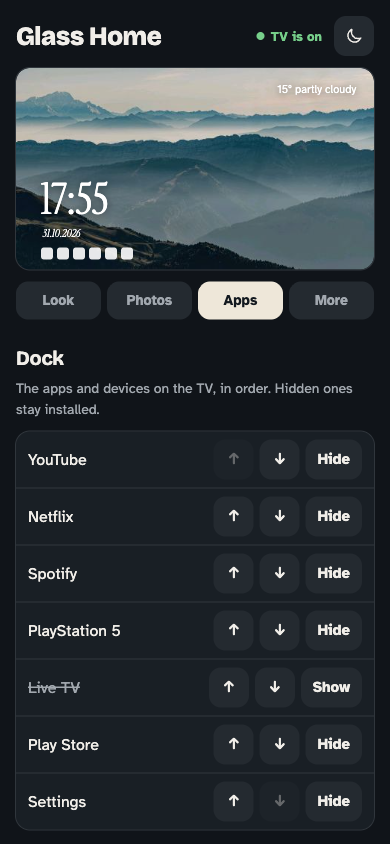
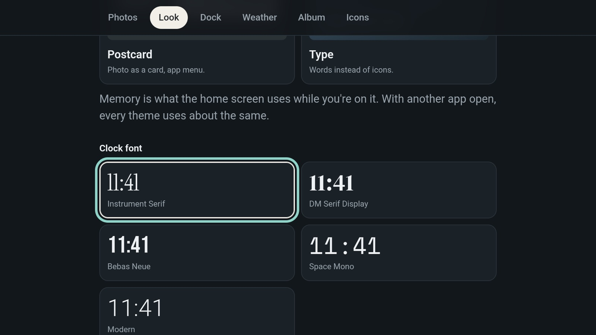

# Using Glass Home

## The remote

- **OK** opens a tile. **Hold OK** for its menu: move, hide, change icon, put
  on a colour button, uninstall, app info, wallpaper, Glass Home settings,
  set up from your phone.
- **Uninstall** is there for apps you (or Google TV) installed; Android asks
  before removing anything. Apps built into the TV can't be removed: **App
  info** opens the system page where they can be switched off, stopped or
  have their updates removed.
- **Back** closes a menu; on the home screen it does nothing.
- **Colour buttons** open the tiles you put on them, while the home screen is
  in front.

<p align="center">
  
</p>

## Set up from your phone

Hold **OK** on any app and choose **Set up from your phone**. Scan the code
with your phone's camera: the TV's website opens and you're signed in. Or
type `glasshome.local:8090` on a phone on the same Wi-Fi and enter the code.
**New code** on that panel signs every phone out.

<p align="center">
  
</p>

The website shows the TV as it is right now at the top: its photo with the
clock, date, weather and dock drawn the way you set them. Below it, four tabs:

- **Look**: theme, clock (24 h, 12 h or the TV's setting), clock font, date,
  weather style and night mode.
- **Photos**: add photos, shuffle or your own order, how long each one stays,
  slow zoom on or off.
- **Apps**: the dock in order, hide or show, and the colour buttons.
- **More**: language, the Home button, the weather city, a shared iCloud or
  Google Photos album, updates, icons.

It follows the phone's light or dark setting; the sun/moon button at the top
switches it.

<p align="center">
  
  &nbsp;&nbsp;
  
</p>

## Settings on the TV

No phone at hand? Open **Home settings**, the last tile on the dock (the same
as **Glass Home settings** in the hold-OK menu). The same website opens on the
TV, already signed in. Arrows move between controls, **OK** picks, **Back**
closes it. Adding photos and icons needs a phone; everything else works with
the remote.

<p align="center">
  
</p>

## Updates

When a new release is out, the home screen asks **Install**, **Later** or
**Skip this version**; nothing installs without Install. Details:
[INSTALL.md](INSTALL.md#updates).

## Languages

English, Ukrainian and Belarusian: More > Language on the website. All text is
in [app/src/main/assets/i18n](../app/src/main/assets/i18n). To add a language,
copy `en.json` to a new file (for example `pl.json`), set `language.name` and
`language.tag` and translate the rest; missing keys fall back to English.

## Official logos

Icons for PlayStation, Xbox, Nintendo Switch and Apple TV are drawn from
scratch. If you'd rather have the brand logos on your own TV:

```sh
python3 scripts/dev/make-official-icons.py   # downloads logos from Wikimedia Commons (macOS)
scripts/dev/push-icons.sh                    # debug builds; or upload the PNGs on the phone website
```

The logos are trademarks of their owners. They stay on your computer and
your TV and are never part of this repository or the APK.

## Good to know

- **Google TV** ignores a third-party Home app while its own launcher is on,
  and disabling the launcher or the setup wizard is risky (on the test TV it
  cut the network). So `set-home.sh` keeps both and turns on a small
  accessibility service that catches the Home key and opens Glass Home.
  Holding Home no longer opens the Google TV panel. If catching the key doesn't
  work on your TV, set **More > Home button > After Google TV** on the website.
- **Force stop** on Glass Home, and some system updates, switch that service
  off. Home then opens Google TV until you run `scripts/install/set-home.sh`
  or turn it on in Settings > Accessibility > Glass Home.
- **Google Photos albums** are read from the public share page, which Google
  can change at any time. iCloud shared albums use Apple's web API.

## Privacy

The app talks to: Open-Meteo for weather (once you pick a city), your shared
album's host (once you add a link), and GitHub once a day to look for a new
release (a few hours later again if it didn't answer; the APK itself comes
from GitHub's download servers; off with More > Updates on the website). The
update check sends nothing about you or the TV beyond what any web request
carries.

The accessibility service that makes Home open Glass Home sees the keys
pressed on the remote, because that is how Android lets an app catch Home. It
acts only on Home, keeps nothing, sends nothing and cannot read what is on
screen; it logs only the time Home was pressed, for the speed numbers.

The phone website only answers devices on your home network, needs the code
from the TV, and uses plain HTTP, so anyone on the same Wi-Fi could read the
traffic. Guessing the code is limited: 5 wrong codes lock that phone out for 5
minutes, and 20 wrong codes from any phones lock sign-in for everyone and
replace the code (each lockout in a row lasts twice as long). Phones stay
signed in for 30 days.
